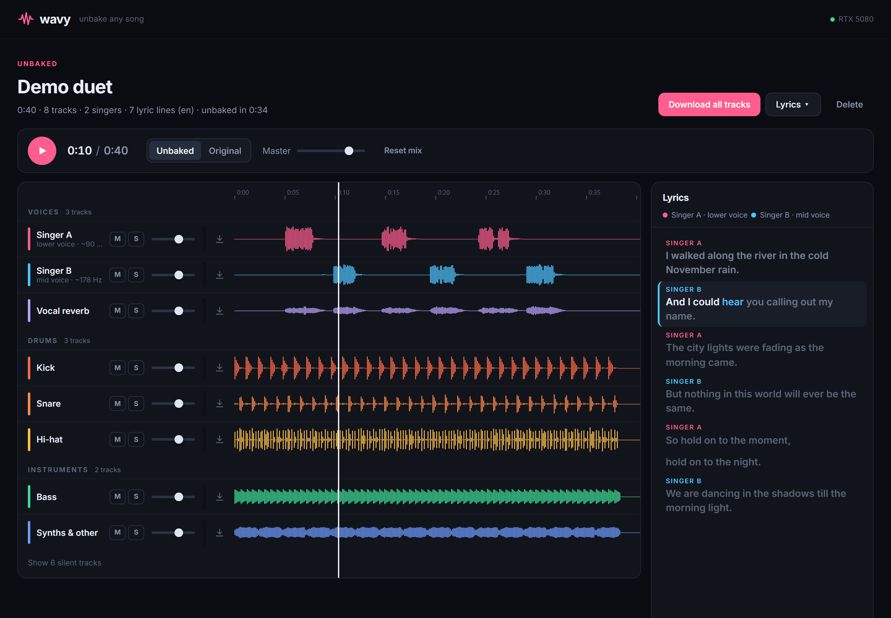
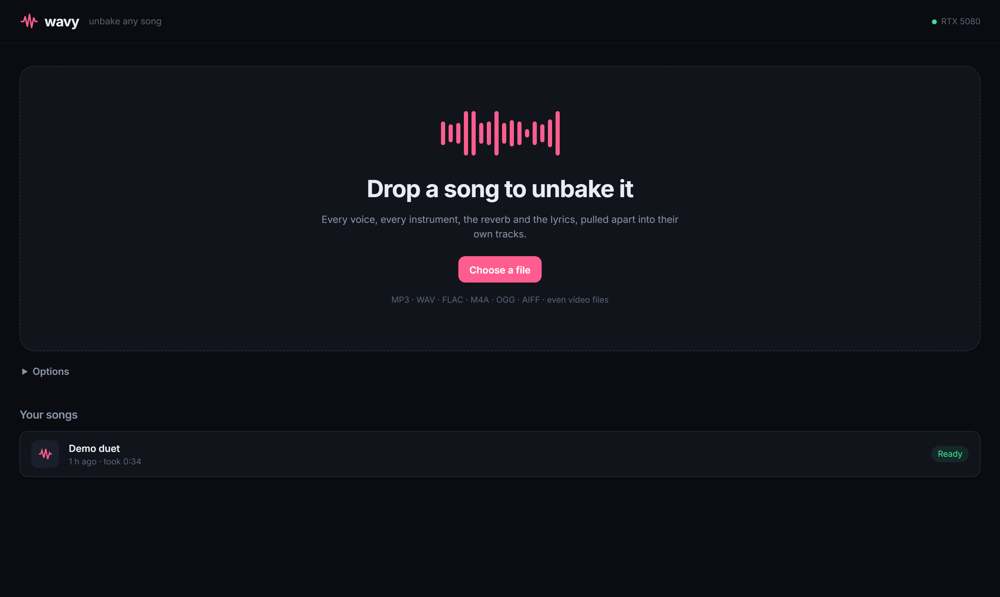
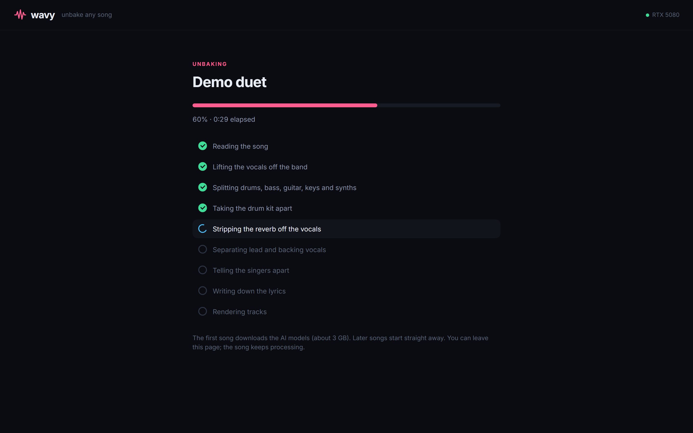

# Wavy: unbake any song

**Drop in a song. Get every singer, every instrument, the reverb and the lyrics on their own tracks.**



A finished song is "baked": vocals, drums, guitar, synths and reverb are all summed into one
waveform. Wavy chains state-of-the-art open-source AI models to pull it back apart. You get
**one track per singer**, backing vocals, the vocal reverb, the drum kit piece by piece (kick,
snare, hi-hat, cymbals), bass, guitar, keys and synths. You also get **word-synced lyrics**, with
each line tagged by who sings it.

It runs locally on your machine. No uploads, no accounts, no subscription.

## Quick start

**Windows**: install [Python 3.12](https://www.python.org/downloads/) and ffmpeg
(`winget install Gyan.FFmpeg`), then:

```bat
git clone https://github.com/estrimaitis/wavy.git
cd wavy
start.bat
```

**macOS / Linux**: install Python 3.11 or 3.12 and ffmpeg (`brew install ffmpeg` / `sudo apt install ffmpeg`), then:

```bash
git clone https://github.com/estrimaitis/wavy.git
cd wavy
./start.sh
```

The first launch installs everything into a local `.venv`. Your first song also downloads about
3 GB of AI models. After that, Wavy opens at **http://localhost:7860**: drag a song (MP3, WAV,
FLAC, M4A, OGG, AIFF, or even a video file) anywhere onto the page.

**Hardware:** an NVIDIA GPU is strongly recommended. On an RTX 5080 a song takes roughly 60% of its
own length (a 6-minute song in about 3.5 minutes). Peak RAM stays under 7 GB even for a 12-minute
song, so 16 GB machines are fine. CPU and Apple Silicon work, just much slower. Developed and tested on Windows 11; the
macOS/Linux scripts are untested.

| Drop a song | Watch it come apart |
|---|---|
|  |  |

## What you get

| Group | Tracks |
|---|---|
| Voices | **Singer A, Singer B, …** (one per detected voice), Backing vocals, Vocal reverb |
| Drums | Kick, Snare, Toms, Hi-hat, Ride, Crash (or a single Drums track if the kit split is off) |
| Instruments | Bass, Guitar, Piano & keys, Synths & other |
| Lyrics | Karaoke-style synced view, plus `.lrc`, `.srt` and `.txt` downloads |

The mixer gives every track mute, solo (Ctrl+click for exclusive solo), a volume fader, a level
meter, a waveform you can click to seek, and its own download button. **Original / Unbaked** lets
you A/B against the source mix. **Download all tracks** gives you a zip of 24-bit WAVs plus the
lyric files. The tracks are designed to add back up to the original song.

## How it works

```
mix ─┬─ vocals ── de-reverb ─┬─ reverb tail ................................ Vocal reverb
     │                       └─ dry ── lead/backing ─┬─ lead ── diarize ──── Singer A, Singer B, …
     │                                                └─ backing ............ Backing vocals
     └─ instrumental ── 6-stem ─┬─ drums ── drum-kit split ───────────────── kick/snare/toms/hh/ride/crash
                                └─ bass, guitar, piano, other
dry vocals ── Whisper large-v3 ── words + timings ── tagged with the singer at each moment
```

| Step | Model |
|---|---|
| Vocals vs. band | BS-Roformer (viperx, SDR 12.97) |
| Band → 6 stems | BS-Roformer-SW |
| Drum kit → pieces | MDX23C DrumSep |
| De-reverb | MDX23C De-Reverb. It scored best on our ground-truth test; the Roformer de-reverbs barely touched the test reverb |
| Lead vs. backing | Mel-Roformer Karaoke |
| Who is singing | WavLM speaker embeddings + pitch, clustered (1 to 4 singers, chosen automatically) |
| Lyrics | faster-whisper large-v3, with word timestamps, energy-gated against hallucinations |

The separation models run through [python-audio-separator](https://github.com/nomadkaraoke/python-audio-separator).

### Honest limits

- **Singers singing at the same time** (a duet in unison or harmony) can't be split by voice
  identity. The lead/backing model pulls most harmonies onto the backing track, and the rest goes
  to whoever dominates at that moment. Turn-taking duets (verse/verse, call-and-response) split
  cleanly.
- Singers are told apart by voice identity, not pitch, so one singer jumping to a higher register
  for the chorus stays one singer.
- "Singer A / B" are named by order of appearance. The *lower voice / higher voice* note comes
  from measured pitch. The app doesn't guess anyone's gender.
- "Synths & other" is the catch-all for anything that isn't vocals, drums, bass, guitar or piano:
  strings, brass, pads, FX.
- Lyrics on heavily processed or screamed vocals will be rougher.

## Measured quality

`tools/make_test_song.py` builds a synthetic duet with known ingredients: a male and a female TTS
voice, drums, bass, a synth pad and a plate reverb. `tools/evaluate.py` scores Wavy's output
against those ingredients (SDR in dB; higher is better, and above 10 is clean):

| Ingredient | SDR |
|---|---|
| Male voice → Singer A | 14.2 dB |
| Female voice → Singer B | 14.8 dB |
| Vocal reverb tail | 2.9 dB (the hardest part: reverb is diffuse and quiet) |
| All vocals incl. reverb | 18.2 dB |
| Drums | 23.5 dB |
| Bass | 20.5 dB |
| Synth pad | 17.9 dB |

The lyrics came back word-perfect, and each line went to the right singer.

`tools/singer_bench.py` checks the singer split on scenarios with a known answer:

| Scenario | Singers found | Per-voice SDR |
|---|---|---|
| Solo male, verse + chorus 5 semitones higher | 1 of 1 | 13.2 dB |
| Solo female, verse + chorus 5 semitones higher | 1 of 1 | 15.2 dB |
| Duet, alternating lines | 2 of 2 | 14.1 / 13.9 dB |
| Duet, high male vs. female | 2 of 2 | 14.7 / 14.6 dB |
| Duet, trading half-lines back to back | 2 of 2 | 11.8 / 13.9 dB |
| Duet, last two lines sung together | 2 of 2 | 2.3 / 3.0 dB (overlap can't be split, see limits) | To reproduce:

```
rem setup.bat already generated samples\demo_duet.wav and its ground truth (Windows only)
.venv\Scripts\python -m server.cli samples\demo_duet.wav data\cli\demo
.venv\Scripts\python tools\evaluate.py data\cli\demo samples\demo_duet_truth
```

## Tests

```bat
.venv\Scripts\python -m pip install -r requirements-dev.txt
rem 25 fast unit + API tests, a few seconds
.venv\Scripts\python -m pytest -m "not slow"
rem the real models on awkward inputs, about 15 minutes on a GPU
.venv\Scripts\python -m pytest -m slow
rem singer-split scenarios with known answers (Windows, uses the built-in voices)
.venv\Scripts\python tools\singer_bench.py
```

The slow suite throws mono, 8 kHz, 96 kHz, 5.1 surround, Opus, video files, non-English
filenames, 1-second clips, digital silence, pure noise, a video with no audio, an empty file and a
12-minute song at the pipeline, and checks it either succeeds or fails with a readable message.

## Project layout

```
server/
  app.py        FastAPI: upload, jobs, stems, zip, lyrics exports; serves web/
  jobs.py       on-disk job store (data/jobs/<id>/) + single GPU worker queue
  pipeline.py   the unbaking pipeline
  separate.py   audio-separator wrapper (model choice lives here)
  singers.py    singer diarization → one track per voice
  lyrics.py     Whisper transcription, line building, LRC/SRT/TXT
  audio_io.py   ffmpeg decode, WAV I/O, waveform peaks
  cli.py        python -m server.cli song.mp3 [out_dir]   (no UI)
web/            the UI (plain HTML/CSS/JS, Web Audio mixer)
tools/          test-song generator + evaluator
models/         downloaded model weights (git-ignored)
data/           your songs and their stems (git-ignored)
```

## Credits & license

Wavy's own code is MIT licensed (see [LICENSE](LICENSE)). The heavy lifting is done by models
other people trained and shared. They are downloaded at runtime, and each has its own license;
check them before any commercial use:

- [python-audio-separator](https://github.com/nomadkaraoke/python-audio-separator), which runs all the separation models
- BS-Roformer (viperx), BS-Roformer-SW (jarredou), MDX23C DrumSep and De-Reverb (aufr33 & jarredou), and Mel-Roformer Karaoke (aufr33 & viperx), from the UVR community
- [Whisper](https://github.com/openai/whisper) via [faster-whisper](https://github.com/SYSTRAN/faster-whisper), for the lyrics
- [WavLM](https://huggingface.co/microsoft/wavlm-base-plus-sv) (Microsoft), for telling the singers apart

Please respect artists' rights: use the stems for practice, study, remixing your own work, or music
you're licensed to use.

